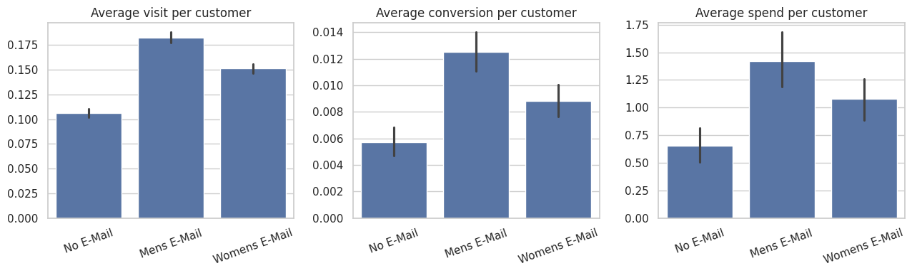
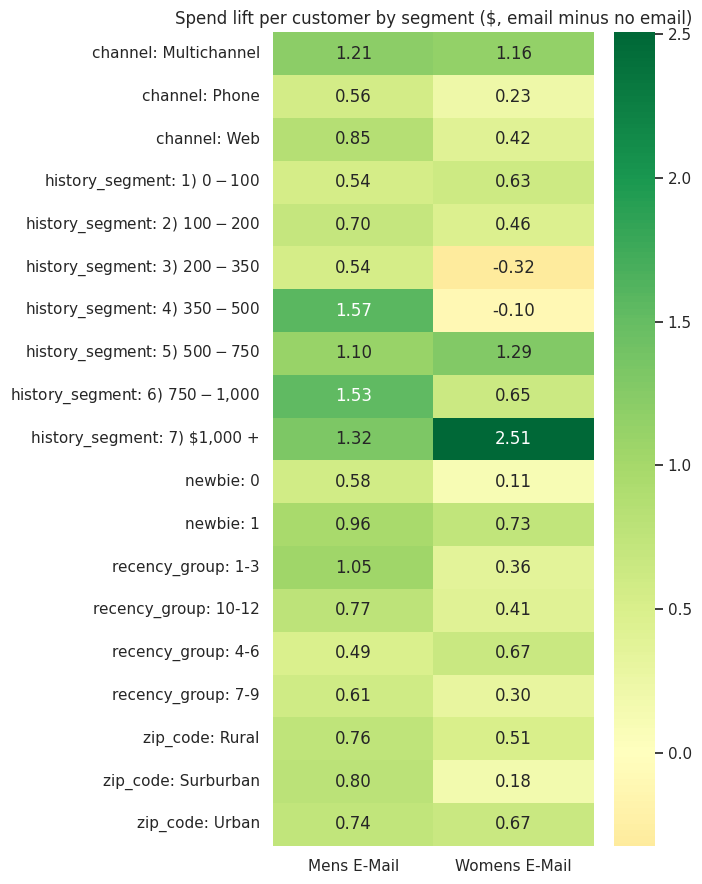
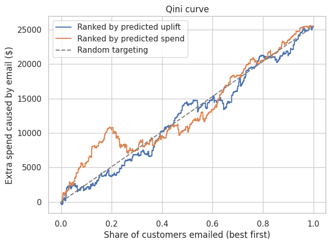

# Who should get the email? Uplift targeting on a 64,000-customer randomised test

**Business question:** should we send the men's email, the women's email, or nothing, and to which
customers, to make the most extra profit?

**Answer:** send the men's email to everyone and keep a small no-email holdout. It earns about
**$131 extra profit per 1,000 customers**. A cross-validated uplift model that picked customers one by one
earned less ($73), in every margin and cost scenario tested.

## Results
| | Visit lift | Conversion lift | Spend lift per customer (95% CI) |
|---|---|---|---|
| Men's email | +7.7 points (10.6% → 18.3%) | +0.68 points | **+$0.77** ($0.50 to $1.07) |
| Women's email | +4.5 points | +0.31 points | **+$0.42** ($0.18 to $0.68) |

| Option (30% margin, $0.10 per email) | Extra profit per 1,000 customers |
|---|---|
| Email nobody | $0 |
| Email everyone: women's | $27 |
| **Email everyone: men's** | **$131** (95% range $42 to $211) |
| Uplift targeting rule | $73 |



## Method
1. **Was the test fair?** Sample-ratio check (chi-square 0.2, cut-off 5.99) and a balance table: every gap under 0.01 standard deviations.
2. **Lift with confidence intervals:** t-statistic and a 2,000-round bootstrap. Minimum detectable effect: $0.31 of spend per customer.
3. **Which segments respond?** 38 segment tests with permutation p-values, corrected with Benjamini-Hochberg: 25 significant before correction, 22 after (3 false alarms avoided).
4. **Uplift model:** T-learner (one gradient-boosting model per arm) with 5-fold cross-validation, checked with a Qini curve.
5. **Money:** inverse-probability-weighted policy value, a 500-round bootstrap, and a margin × cost sensitivity table.



## Why targeting did not win
- The men's email lifts spend for almost every kind of customer, so there are few people worth skipping.
- An email costs $0.10 while the average extra gross profit is about $0.23 per customer, so mailing everyone already pays.
- Only about 0.9% of customers buy within 2 weeks, so per-customer predictions are noisy. On the Qini curve, ranking by uplift is no better than random or "big spenders first".



**Limits:** 2 weeks of data, no unsubscribe or complaint data, and margin and cost are assumptions (tested in the sensitivity table).

## Run it
```bash
pip install -r requirements.txt
jupyter notebook email_uplift_targeting.ipynb
```

**Data:** Kevin Hillstrom's *MineThatData E-Mail Analytics and Data Mining Challenge* (2008), a public dataset of
64,000 customers randomly assigned to men's email, women's email or no email.

**Tools:** Python, pandas, numpy, matplotlib, seaborn, scikit-learn.
